<!-- Generated by scripts/build.py from profile.json. Edit profile.json, not this file. -->

<picture><source media="(prefers-color-scheme: dark)" srcset="./assets/generated/hero-dark.svg"></picture>

<a href="https://www.linkedin.com/in/shoaib-ul-haq-021376267/">LinkedIn</a> · <a href="mailto:shoaibulhaqq@outlook.com">Email</a>

I'm a software engineer with a Computer Systems Engineering background. I mostly work on the backend: APIs, data models, background jobs, and the infrastructure they run on. Lately that includes LLM features inside real applications.

I like systems that are easy to reason about: clear boundaries, failures handled on purpose, and enough logging and metrics to know what is going on.

### Working on

<picture><source media="(prefers-color-scheme: dark)" srcset="./assets/generated/now-0-dark.svg"></picture>

### Stack

<picture><source media="(prefers-color-scheme: dark)" srcset="./assets/generated/stack-dark.svg"></picture>

This page rebuilds itself from <code>profile.json</code> and the GitHub API.
